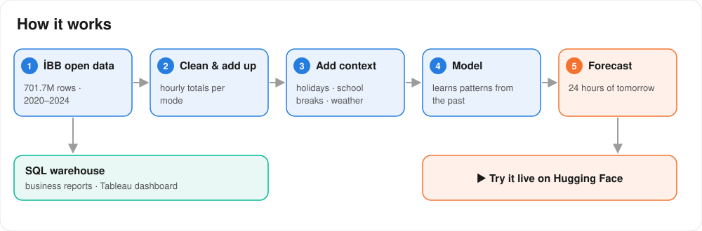
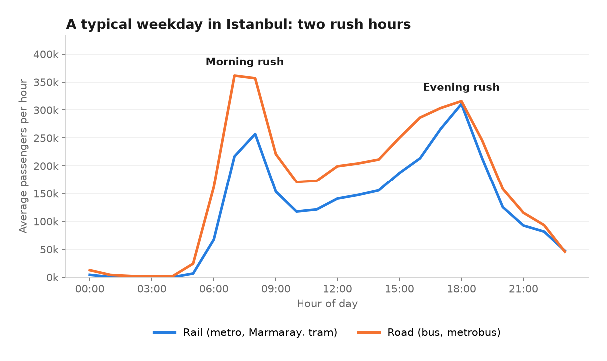
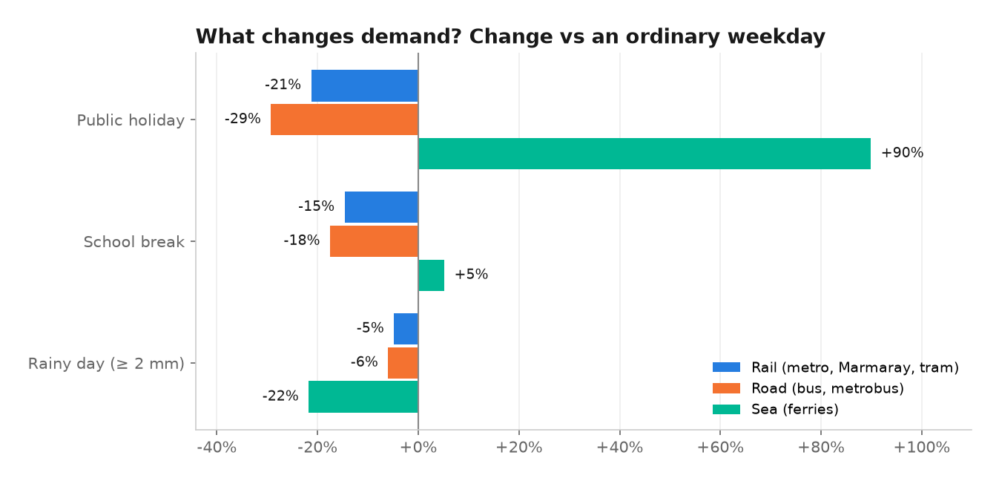
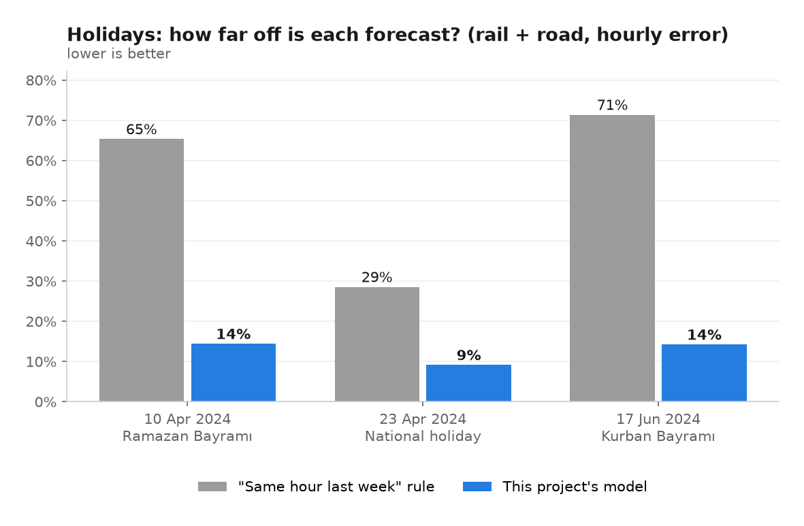
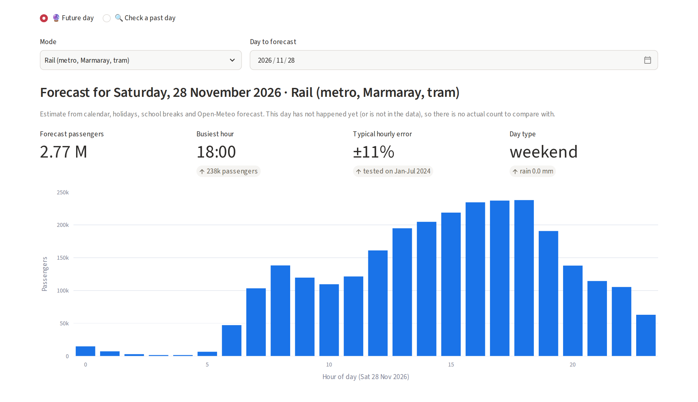
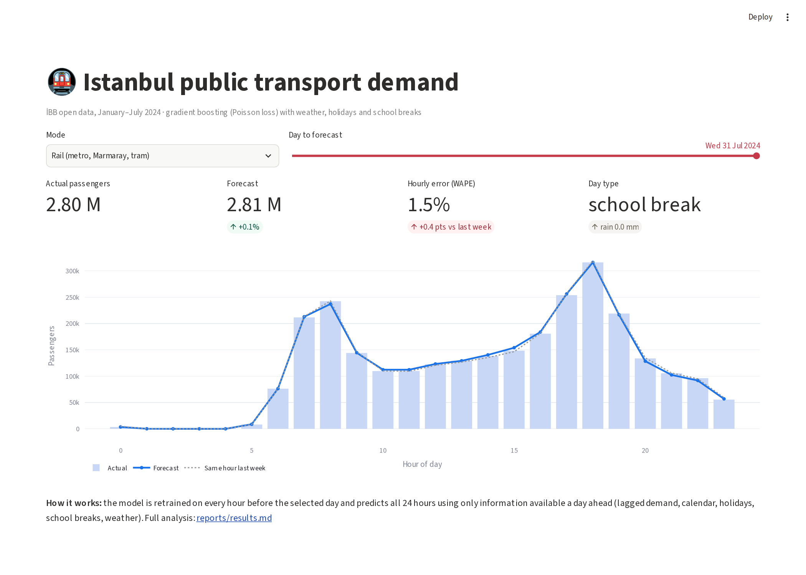
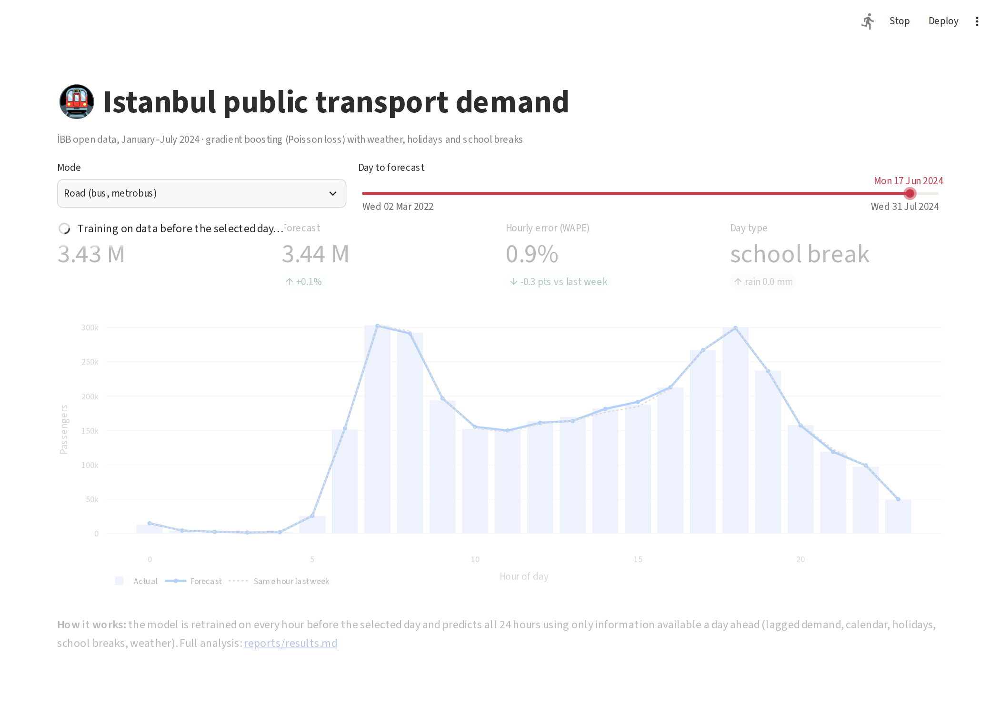

# 🚇 Istanbul Public Transport: Analytics & Demand Forecasting

**How many people will ride Istanbul's metro, buses and ferries tomorrow, hour by hour?**

This project learns from 701.7 million rows of Istanbul's open transport data and answers that question. It also explains what moves demand: holidays, school breaks, rain. You can try it in your browser, no install needed.

[](https://huggingface.co/spaces/yagmurtuncer/istanbul-transit-demand) [](https://huggingface.co/yagmurtuncer/istanbul-transit-demand-gbm) [](https://huggingface.co/datasets/yagmurtuncer/istanbul-public-transport-ridership-2020-2024) [](https://www.kaggle.com/datasets/nuryamurtuncer/istanbul-public-transport-hourly-passengers-2024) [](https://public.tableau.com/app/profile/ya.mur.tuncer/viz/IstanbulPublicTransportAnalytics2020-2024/Recoveryindex)

**English** · [Türkçe](README.tr.md)

## What is this?

Istanbul's rail, bus and ferry networks carry millions of trips a day. Operators decide a day ahead how many trains, buses and ferries to run and how many staff to schedule. The usual rule of thumb is *"expect what we saw at the same hour last week"*, and it breaks down on exactly the days that matter most: holidays, school breaks, rainy days.

This project does three things:

- **Forecasts** next-day passengers for every hour, for rail, road and sea.
- **Explains** what changes demand, with proper statistical tests.
- **Answers business questions** from a SQL warehouse: which lines are busiest, how the network recovered after the pandemic, who pays which fare.



## What can it tell you?

| Question | Answer from the data |
|---|---|
| Can we forecast tomorrow, hour by hour? | Yes. Hourly error is **5.6% on rail, 5.2% on road and 8.7% on ferries**, about 60% lower than the "same hour last week" rule. |
| When is the network busiest? | Two rush hours on weekdays: around **07:00–08:00** and **18:00**. Metrobüs 34 alone moves **~73,000 passengers** in its 18:00 hour. |
| What happens on holidays? | Rail drops about **21%**, buses **29%**, while ferries rise about **90%**. |
| And on rainy days? | Every 10 mm of rain lowers demand about 6%; ferries drop **22%**. |
| Has the network recovered from the pandemic? | Rail is at **123%** of its pre-pandemic level, buses at **94%**: demand has moved to rail. |
| Who pays what? | 45% student cards, 37% full fare, 14% free, 3% teacher / 60+ (2023). |

Details: [business insights](reports/business_insights.md) · [what drives demand](reports/factors.md) · [model results](reports/results.md)

## A day in Istanbul



## What changes demand?



Holidays and school breaks lower rail and bus use, while ferries fill up on holidays. Rain keeps people off the ferries most of all. All of these effects are statistically significant (bootstrap 95% CI and Mann-Whitney U, p < 0.01).

## Where the model shines: holidays



On holidays the "same hour last week" rule is off by 29–71%. The model knows the calendar, so it stays within 9–14%.

## Try it live

**▶️ [huggingface.co/spaces/yagmurtuncer/istanbul-transit-demand](https://huggingface.co/spaces/yagmurtuncer/istanbul-transit-demand)**: runs entirely in your browser, no install. The first load takes 30–60 seconds.

The demo has two views:

- **🔮 Future day:** pick any date, tomorrow by default, and see its 24-hour forecast from the calendar, holidays, school breaks and the weather forecast.
- **🔍 Check a past day:** pick a day between 2022 and 2024. The model trains only on data *before* that day, and its forecast is shown next to what really happened.

**Future day**



| A normal day: rail, 31 July 2024 | A holiday: buses, 17 June 2024 (Kurban Bayramı) |
|---|---|
|  |  |

Screenshots and charts are regenerated automatically by the Analysis workflow whenever the data or code change.

## Data

| Source | Content |
|---|---|
| [İBB Açık Veri: Saatlik Toplu Ulaşım](https://data.ibb.gov.tr/dataset/hourly-public-transport-data-set) | Hourly passenger counts by mode, line and transfer type, January 2020 – October 2024 (701.7 million rows) |
| [Open-Meteo](https://open-meteo.com/) | Hourly temperature, rain, snow and wind |
| [`holidays`](https://pypi.org/project/holidays/) + MEB calendars | Turkish public and religious holidays, eves, school breaks |

The aggregated data is published on [Hugging Face](https://huggingface.co/datasets/yagmurtuncer/istanbul-public-transport-ridership-2020-2024) and [Kaggle](https://www.kaggle.com/datasets/nuryamurtuncer/istanbul-public-transport-hourly-passengers-2024) (CC BY 4.0, source: İBB Açık Veri Portalı).

## Technical details

<details>
<summary><b>Approach</b></summary>

1. **Pipeline:** download, clean, aggregate to an hourly panel, fill missing hours explicitly.
2. **Features:** calendar (cyclic hour encoding, weekday, holidays, eves), weather, lagged demand (24 h / 48 h / 168 h) and rolling means. All lag features are built so that a day-ahead forecast never sees the future; a unit test enforces this.
3. **Validation:** expanding-window walk-forward splits; metrics: MAE, sMAPE, WAPE.
4. **Models:** seasonal naive → ridge → gradient boosting (scikit-learn with a Poisson loss, and XGBoost), explained with SHAP.
5. **Statistics:** bootstrap confidence intervals and Mann-Whitney tests, plus a multivariate regression that separates holidays, bridge days, school breaks, Ramadan, elections and weather.
6. **MLOps:** MLflow tracking, a Docker image on GitHub Container Registry, GitHub Actions for tests, reports, the SQL warehouse and retraining, and a Streamlit dashboard.

The **Future day** view uses a second model without lagged demand, so it can forecast any date after the data ends. Trained on 2022–2023 and tested on January–July 2024, its hourly error is 10.6% (rail), 12.1% (road) and 16.3% (ferries).
</details>

<details>
<summary><b>SQL warehouse (DuckDB)</b></summary>

`warehouse/sql/` builds a star schema in four layers: **staging** views over the extracts → **dimensions** (`dim_date` with holidays, school breaks, bridge days, Ramadan and elections; `dim_mode`, `dim_line`, `dim_station`, `dim_district`, `dim_fare`, `dim_month_quality`) → **facts** (hourly, line, station, district and fare grain) → **business marts** (monthly KPIs and recovery index, line and station rankings, peak-hour load, fare mix, transfer rate, special-day effect per line). Ten data-quality checks run on every build (for example: hourly, line, district and fare totals must match for every day; partially published months can never count as complete).

```bash
python warehouse/build.py          # ~1 minute: builds data/warehouse.duckdb, runs the checks, exports the marts
python scripts/business_report.py  # writes reports/business_insights.md
```

The marts are exported to [`tableau/istanbul_transit_tableau.xlsx`](tableau/) on every build and visualised in an [interactive Tableau dashboard](https://public.tableau.com/app/profile/ya.mur.tuncer/viz/IstanbulPublicTransportAnalytics2020-2024/Recoveryindex) (recovery index, peak hours by line, fare mix, holiday effect per line).

How the data's quirks are handled: August–October 2024 are only partially published (flagged, excluded from KPIs); 55% of bus boardings are recorded under the district Bakırköy (district analysis uses rail and ferries only); fare codes are mapped with İBB's own card-type dataset (its 2023 shares match ours within one point).
</details>

<details>
<summary><b>Detailed results</b></summary>

Findings on January 2022 – July 2024 (943 days, 6.07 billion passengers), working days:

- **Public holidays** cut weekday demand by about **21% on rail** and **29% on buses**, while **ferry** use rises by about **90%**.
- **School breaks** lower weekday demand by about **15% on rail** and **18% on buses**; ferries rise slightly (+5%).
- **Rain** (≥ 2 mm during the day) reduces demand by about **5% on rail**, **6% on buses** and **22% on ferries**. This became visible after separating school breaks from term time: the two effects were masking each other.
- **Gradient boosting with a Poisson loss** reaches a day-ahead hourly WAPE of **5.6% (rail)**, **4.7% (road, tuned)** and **8.7% (ferries)**, about **60% lower error** than a same-hour-last-week baseline. Using the weather forecast issued the day before instead of the observed weather changes it by less than half a point.
- A multivariate regression that holds weekday, month, year and weather fixed separates the calendar further (bridge days −31%, elections −30%, single-day national holidays barely affect rail): [reports/factors.md](reports/factors.md).

Full tables and figures: [reports/results.md](reports/results.md), SHAP explanations: [reports/explainability.md](reports/explainability.md).
</details>

<details>
<summary><b>Quick start</b></summary>

```bash
python -m venv .venv && source .venv/bin/activate
pip install -e ".[dev]"
pytest                                   # cleaning, leakage, validation, holidays, bootstrap
python scripts/run_analysis.py           # EDA, statistical tests, model comparison -> reports/
python scripts/readme_figures.py         # the charts in this README
python scripts/run_phase1.py --months 6  # optional: re-download raw months from İBB
```

Dashboard locally:

```bash
pip install -e ".[app]"
streamlit run app/streamlit_app.py
```

Or with Docker: `docker run -p 8501:8501 ghcr.io/yagmurtncr/istanbul-transit-demand:latest`, then open http://localhost:8501.
</details>

<details>
<summary><b>Project structure</b></summary>

```
app/         Streamlit dashboard (also runs in the browser on Hugging Face)
src/transit/
  data/      download, cleaning, weather, holidays and school calendar
  features/  calendar, lag and rolling features
  models/    walk-forward validation, baselines, training
  analysis/  statistical tests
warehouse/   DuckDB star schema, marts and data-quality checks
scripts/     analysis, reports, README figures, dashboard screenshots
reports/     generated reports and figures
tests/       unit tests, including a look-ahead leakage test
```
</details>

## License

Code: MIT. Data: İBB Open Data Licence and Open-Meteo terms; cite "Kaynak: İBB Açık Veri Portalı".
