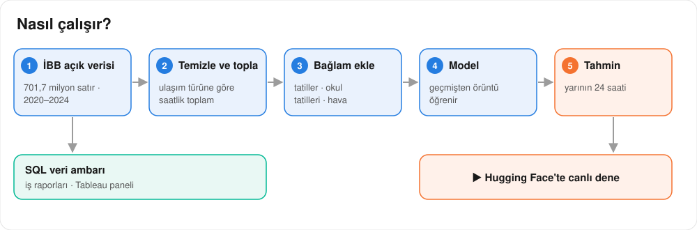
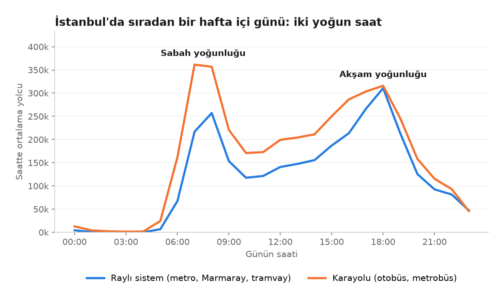
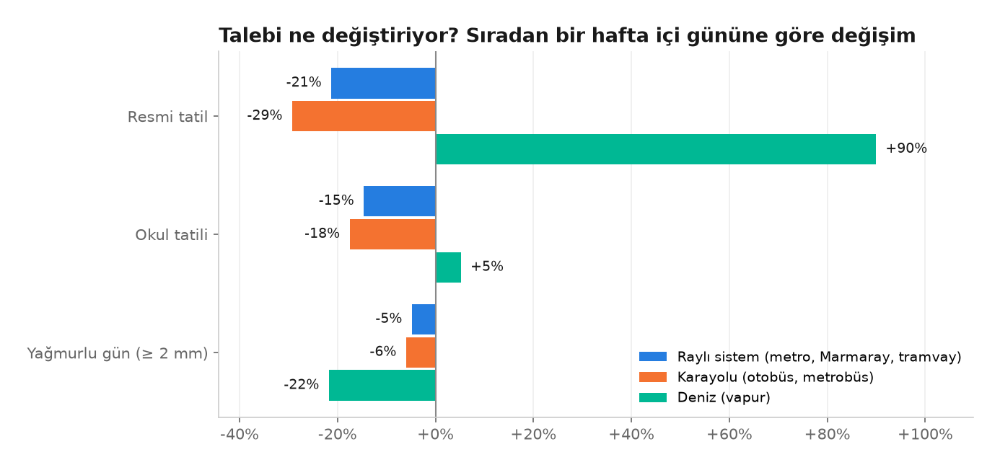
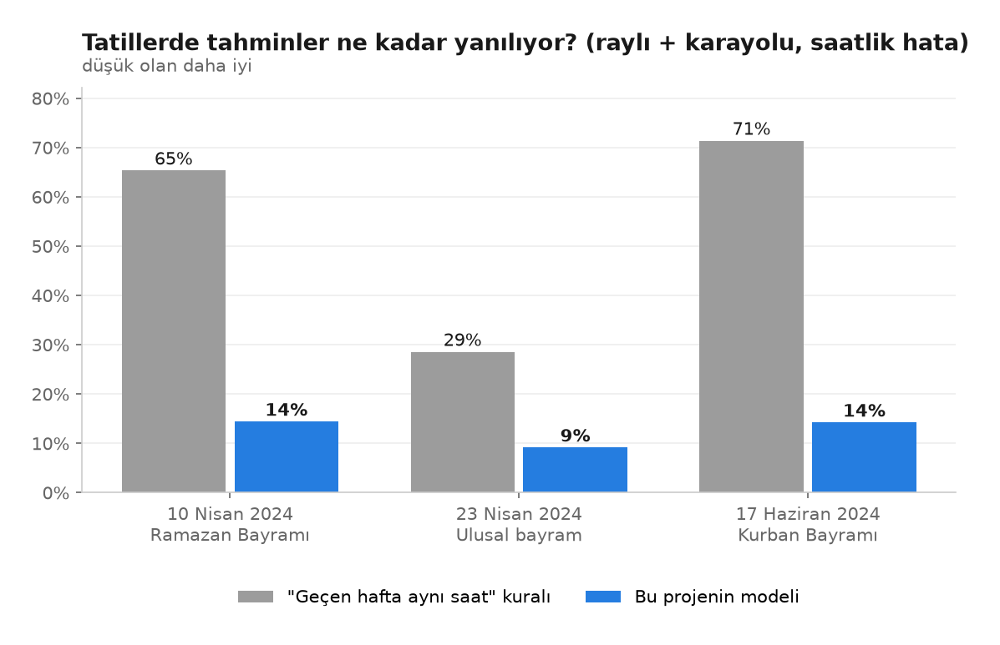
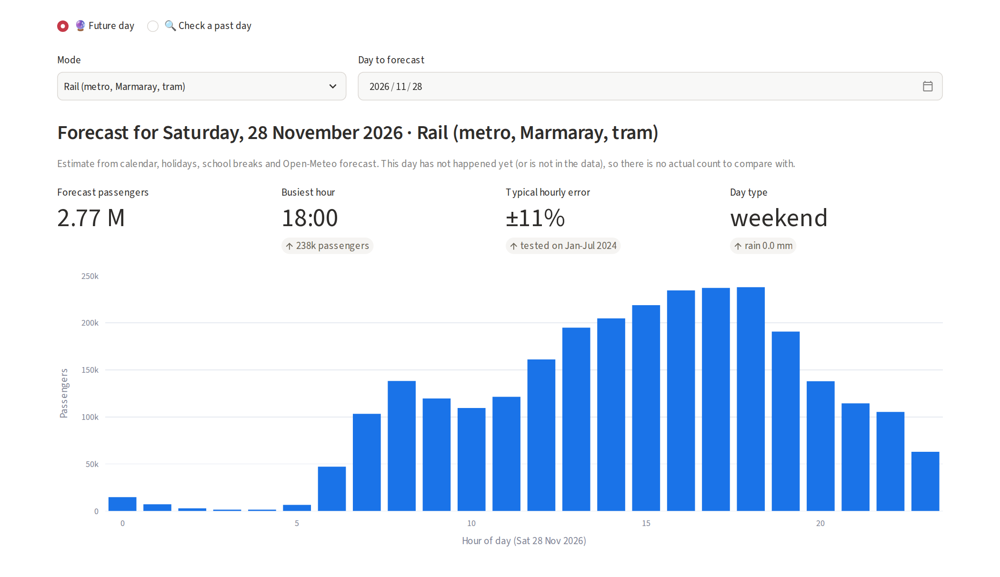
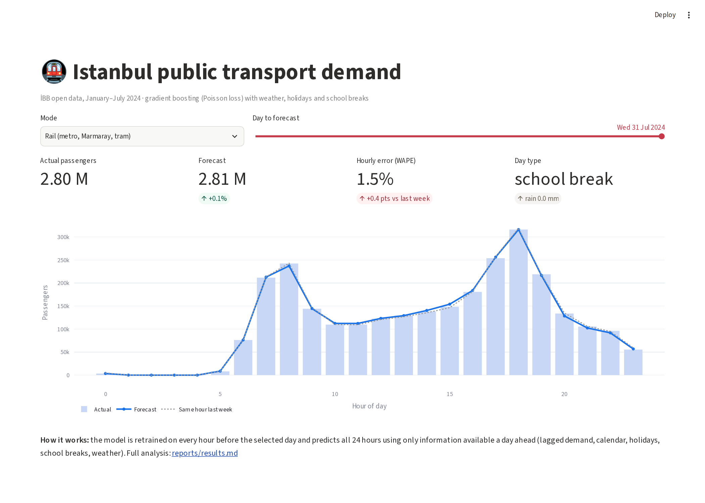
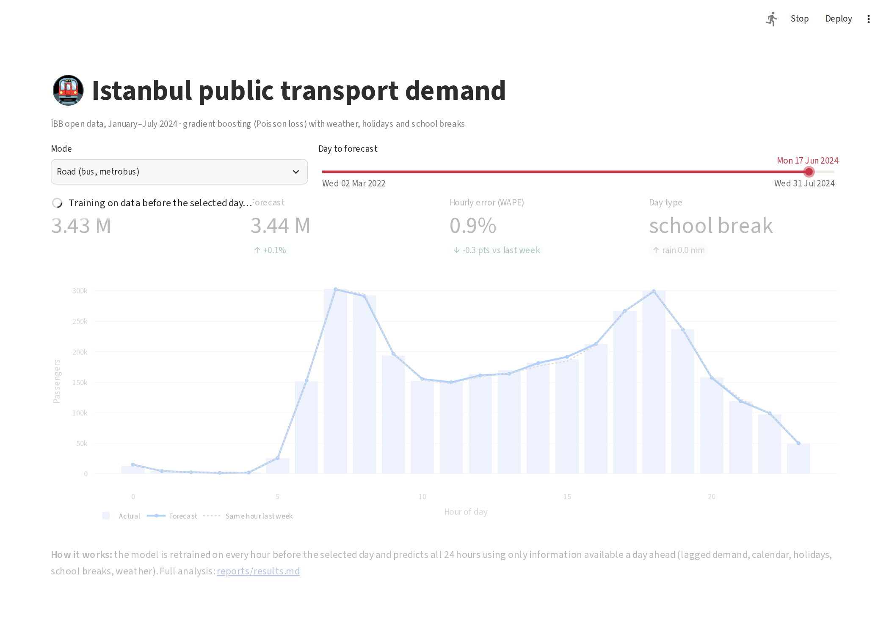

# 🚇 İstanbul Toplu Ulaşımı: Analiz ve Talep Tahmini

**Yarın İstanbul'da metroya, otobüse ve vapura saat saat kaç kişi binecek?**

Bu proje, İstanbul'un açık ulaşım verisindeki 701,7 milyon satırdan öğrenerek bu soruyu yanıtlıyor. Talebi neyin değiştirdiğini de açıklıyor: resmi tatiller, okul tatilleri, yağmur. Hiçbir şey kurmadan tarayıcında deneyebilirsin.

[](https://huggingface.co/spaces/yagmurtuncer/istanbul-transit-demand) [](https://huggingface.co/yagmurtuncer/istanbul-transit-demand-gbm) [](https://huggingface.co/datasets/yagmurtuncer/istanbul-public-transport-ridership-2020-2024) [](https://www.kaggle.com/datasets/nuryamurtuncer/istanbul-public-transport-hourly-passengers-2024) [](https://public.tableau.com/app/profile/ya.mur.tuncer/viz/IstanbulPublicTransportAnalytics2020-2024/Recoveryindex)

[English](README.md) · **Türkçe**

## Bu proje nedir?

İstanbul'da raylı sistemler, otobüsler ve vapurlar günde milyonlarca yolcu taşıyor. İşletmeler kaç sefer yapılacağına ve kaç personel çalıştırılacağına bir gün önceden karar veriyor. Genelde kullanılan kural *"geçen hafta aynı saatte ne olduysa yine o olur"*; ama bu kural tam da en önemli günlerde yanılıyor: resmi tatiller, okul tatilleri, yağmurlu günler.

Bu proje üç şey yapıyor:

- **Tahmin eder:** raylı sistem, karayolu ve deniz için ertesi günün her saatindeki yolcu sayısını.
- **Açıklar:** talebi neyin değiştirdiğini, istatistiksel testlerle.
- **İş sorularını yanıtlar:** bir SQL veri ambarından; en yoğun hatlar, pandemiden sonraki toparlanma, kimin hangi tarifeyi ödediği.



## Neler söylüyor?

| Soru | Verinin cevabı |
|---|---|
| Yarını saat saat tahmin edebilir miyiz? | Evet. Saatlik hata **raylıda %5,6, karayolunda %5,2, vapurda %8,7**; "geçen hafta aynı saat" kuralından yaklaşık %60 daha az. |
| Ağ en çok ne zaman yoğun? | Hafta içi iki yoğun saat var: yaklaşık **07:00–08:00** ve **18:00**. Yalnızca Metrobüs 34 hattı 18:00 saatinde **~73.000 yolcu** taşıyor. |
| Resmi tatillerde ne oluyor? | Raylı sistem yaklaşık **%21**, otobüs **%29** azalıyor; vapur ise yaklaşık **%90** artıyor. |
| Ya yağmurlu günlerde? | Her 10 mm yağmur talebi yaklaşık %6 düşürüyor; vapurda düşüş **%22**. |
| Ağ pandemiden sonra toparlandı mı? | Raylı sistem pandemi öncesinin **%123**'ünde, otobüs **%94**'ünde: talep raylı sisteme kaydı. |
| Kim ne ödüyor? | 2023'te kartların %45'i öğrenci, %37'si tam, %14'ü ücretsiz, %3'ü öğretmen / 60 yaş üstü. |

Ayrıntılar (İngilizce): [iş içgörüleri](reports/business_insights.md) · [talebi etkileyenler](reports/factors.md) · [model sonuçları](reports/results.md)

## İstanbul'da bir gün



## Talebi ne değiştiriyor?



Resmi tatiller ve okul tatilleri raylı sistem ve otobüs kullanımını azaltıyor; vapurlar ise tatillerde doluyor. Yağmur en çok vapur kullanımını etkiliyor. Bu etkilerin hepsi istatistiksel olarak anlamlı (bootstrap %95 güven aralığı ve Mann-Whitney U, p < 0,01).

## Modelin öne çıktığı yer: tatiller



Tatillerde "geçen hafta aynı saat" kuralı %29–71 yanılıyor. Model takvimi bildiği için hatayı %9–14'te tutuyor.

## Canlı dene

**▶️ [huggingface.co/spaces/yagmurtuncer/istanbul-transit-demand](https://huggingface.co/spaces/yagmurtuncer/istanbul-transit-demand)**: tamamen tarayıcında çalışır, kurulum gerekmez. İlk açılış 30–60 saniye sürer.

Demoda iki görünüm var:

- **🔮 Future day (gelecek gün):** istediğin bir tarihi seç (varsayılan: yarın); takvim, resmi tatiller, okul tatilleri ve hava tahminiyle o günün 24 saatlik tahminini gör.
- **🔍 Check a past day (geçmiş günü test et):** 2022–2024 arasından bir gün seç. Model yalnızca o günden *önceki* verilerle eğitilir ve tahmini, gerçekte olanla yan yana gösterilir.

**Gelecek gün**



| Sıradan bir gün: raylı sistem, 31 Temmuz 2024 | Bir tatil: otobüs, 17 Haziran 2024 (Kurban Bayramı) |
|---|---|
|  |  |

Ekran görüntüleri ve grafikler, veri ya da kod değiştiğinde Analysis iş akışıyla kendiliğinden yenilenir.

## Veri

| Kaynak | İçerik |
|---|---|
| [İBB Açık Veri: Saatlik Toplu Ulaşım](https://data.ibb.gov.tr/dataset/hourly-public-transport-data-set) | Ulaşım türü, hat ve aktarma tipine göre saatlik yolcu sayıları, Ocak 2020 – Ekim 2024 (701,7 milyon satır) |
| [Open-Meteo](https://open-meteo.com/) | Saatlik sıcaklık, yağmur, kar ve rüzgâr |
| [`holidays`](https://pypi.org/project/holidays/) + MEB takvimleri | Resmi ve dini bayramlar, arifeler, okul tatilleri |

Toplulaştırılmış veri [Hugging Face](https://huggingface.co/datasets/yagmurtuncer/istanbul-public-transport-ridership-2020-2024) ve [Kaggle](https://www.kaggle.com/datasets/nuryamurtuncer/istanbul-public-transport-hourly-passengers-2024) üzerinde yayında (CC BY 4.0, kaynak: İBB Açık Veri Portalı).

## Teknik ayrıntılar

<details>
<summary><b>Yöntem</b></summary>

1. **Veri hattı:** indirme, temizleme, saatlik panele toplulaştırma, eksik saatleri açıkça doldurma.
2. **Öznitelikler:** takvim (döngüsel saat kodlaması, haftanın günü, tatiller, arifeler), hava, gecikmeli talep (24 / 48 / 168 saat) ve hareketli ortalamalar. Gecikmeli özniteliklerin hiçbiri bir gün sonrasının tahmininde geleceği göremez; bunu bir birim testi denetler.
3. **Doğrulama:** genişleyen pencereli ileriye doğru (walk-forward) bölmeler; ölçütler: MAE, sMAPE, WAPE.
4. **Modeller:** mevsimsel naif → ridge → gradient boosting (Poisson kayıplı scikit-learn ve XGBoost), SHAP ile açıklanmış.
5. **İstatistik:** bootstrap güven aralıkları ve Mann-Whitney testleri; ayrıca tatilleri, köprü günlerini, okul tatillerini, ramazanı, seçimleri ve havayı birbirinden ayıran çok değişkenli bir regresyon.
6. **MLOps:** MLflow ile deney takibi, GitHub Container Registry'de Docker imajı, testler, raporlar, SQL ambarı ve yeniden eğitim için GitHub Actions, bir Streamlit paneli.

**Gelecek gün** görünümü gecikmeli talep kullanmayan ikinci bir model kullanır; böylece veri bittikten sonraki herhangi bir tarihi tahmin edebilir. 2022–2023 ile eğitilip Ocak–Temmuz 2024'te denendiğinde saatlik hatası raylıda %10,6, karayolunda %12,1, vapurda %16,3'tür.
</details>

<details>
<summary><b>SQL veri ambarı (DuckDB)</b></summary>

`warehouse/sql/` dört katmanlı bir yıldız şema kurar: ham dosyalar üzerinde **staging** görünümleri → **boyutlar** (tatiller, okul tatilleri, köprü günleri, ramazan ve seçimlerle `dim_date`; `dim_mode`, `dim_line`, `dim_station`, `dim_district`, `dim_fare`, `dim_month_quality`) → **olgular** (saat, hat, istasyon, ilçe ve tarife düzeyinde) → **iş tabloları** (aylık KPI'lar ve toparlanma endeksi, hat ve istasyon sıralamaları, yoğun saat yükü, tarife dağılımı, aktarma oranı, hat bazında özel gün etkisi). Her kurulumda on veri kalitesi denetimi çalışır (örneğin saat, hat, ilçe ve tarife toplamları her gün tutmalıdır; kısmen yayımlanmış aylar asla tam sayılmaz).

```bash
python warehouse/build.py          # ~1 dakika: data/warehouse.duckdb dosyasını kurar, denetimleri çalıştırır, tabloları dışa aktarır
python scripts/business_report.py  # reports/business_insights.md dosyasını yazar
```

İş tabloları her kurulumda [`tableau/istanbul_transit_tableau.xlsx`](tableau/) dosyasına aktarılır ve [etkileşimli bir Tableau panelinde](https://public.tableau.com/app/profile/ya.mur.tuncer/viz/IstanbulPublicTransportAnalytics2020-2024/Recoveryindex) görselleştirilir (toparlanma endeksi, hatlara göre yoğun saatler, tarife dağılımı, hat bazında tatil etkisi).

Verinin özellikleri nasıl ele alındı: Ağustos–Ekim 2024 yalnızca kısmen yayımlanmış (işaretlendi, KPI'lardan çıkarıldı); otobüs binişlerinin %55'i Bakırköy ilçesine yazılmış (ilçe analizi yalnızca raylı sistem ve vapuru kullanır); tarife kodları İBB'nin kendi kart tipi veri setiyle eşleştirildi (2023 payları bizimkilerle bir puan içinde örtüşüyor).
</details>

<details>
<summary><b>Ayrıntılı sonuçlar</b></summary>

Ocak 2022 – Temmuz 2024 (943 gün, 6,07 milyar yolcu), iş günleri:

- **Resmi tatiller** hafta içi talebi **raylıda yaklaşık %21**, **otobüste %29** azaltıyor; **vapur** kullanımı ise yaklaşık **%90** artıyor.
- **Okul tatilleri** hafta içi talebi **raylıda yaklaşık %15**, **otobüste %18** azaltıyor; vapur hafifçe artıyor (+%5).
- **Yağmur** (gündüz ≥ 2 mm) talebi **raylıda yaklaşık %5**, **otobüste %6**, **vapurda %22** azaltıyor. Bu etki, okul tatilleri ders döneminden ayrıldıktan sonra görünür oldu: iki etki birbirini gizliyordu.
- **Poisson kayıplı gradient boosting**, bir gün sonrası için saatlik WAPE'de **%5,6 (raylı)**, **%4,7 (karayolu, ayarlanmış)** ve **%8,7 (vapur)** değerine ulaşıyor; "geçen hafta aynı saat" kuralından yaklaşık **%60 daha az hata**. Gözlenen hava yerine bir gün önce yayımlanan hava tahmini kullanıldığında fark yarım puandan az.
- Haftanın günü, ay, yıl ve havayı sabit tutan çok değişkenli bir regresyon takvim etkilerini daha da ayırıyor (köprü günleri −%31, seçimler −%30, tek günlük ulusal bayramlar raylı sistemi neredeyse etkilemiyor): [reports/factors.md](reports/factors.md).

Tüm tablolar ve grafikler: [reports/results.md](reports/results.md), SHAP açıklamaları: [reports/explainability.md](reports/explainability.md).
</details>

<details>
<summary><b>Hızlı başlangıç</b></summary>

```bash
python -m venv .venv && source .venv/bin/activate
pip install -e ".[dev]"
pytest                                   # temizleme, sızıntı, doğrulama, tatiller, bootstrap
python scripts/run_analysis.py           # keşifsel analiz, istatistik testleri, model karşılaştırması -> reports/
python scripts/readme_figures.py         # bu README'deki grafikler
python scripts/run_phase1.py --months 6  # isteğe bağlı: ham ayları İBB'den yeniden indir
```

Paneli yerelde çalıştırmak için:

```bash
pip install -e ".[app]"
streamlit run app/streamlit_app.py
```

Ya da Docker ile: `docker run -p 8501:8501 ghcr.io/yagmurtncr/istanbul-transit-demand:latest`, ardından http://localhost:8501 adresini aç.
</details>

<details>
<summary><b>Proje yapısı</b></summary>

```
app/         Streamlit paneli (Hugging Face'te tarayıcıda da çalışır)
src/transit/
  data/      indirme, temizleme, hava, tatiller ve okul takvimi
  features/  takvim, gecikme ve hareketli ortalama öznitelikleri
  models/    walk-forward doğrulama, karşılaştırma modelleri, eğitim
  analysis/  istatistik testleri
warehouse/   DuckDB yıldız şema, iş tabloları ve veri kalitesi denetimleri
scripts/     analiz, raporlar, README grafikleri, panel ekran görüntüleri
reports/     üretilen raporlar ve grafikler
tests/       birim testleri (geleceği görme sızıntısı testi dahil)
```
</details>

## Lisans

Kod: MIT. Veri: İBB Açık Veri Lisansı ve Open-Meteo koşulları; "Kaynak: İBB Açık Veri Portalı" diye atıf yapın.
