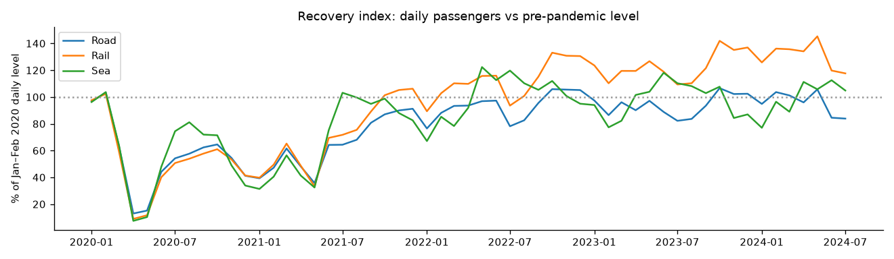
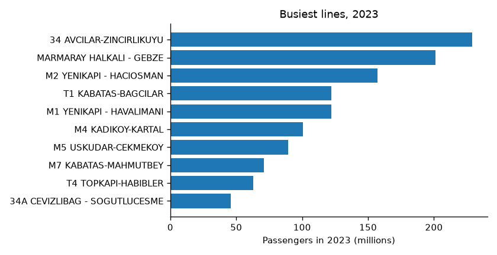
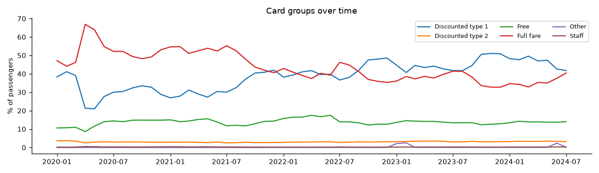
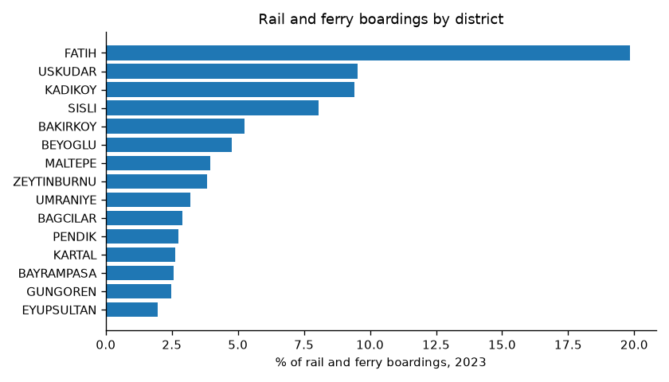

# Business insights: Istanbul public transport

What the İBB ridership data means for **capacity**, **pricing** and **operations**. Every number comes from the DuckDB warehouse (`warehouse/`), complete months only; Covid-19 months and partially published months (Aug–Oct 2024) are flagged in `dim_month_quality`.

## 1. Network health

- **2023:** 2.37 billion passengers, 6.48 million per day, **+4.2%** vs 2022.
- Lowest point: **8%** of the pre-pandemic level (April 2020).
- **Recovery in 2023** vs the January–February 2020 daily level: buses and metrobus **94%**, rail **123%**, ferries **98%**. Rail and ferries are above the pre-pandemic level while road transport is still below it: part of the demand has moved to rail, which gained new lines in this period.

## 2. Capacity: where and when the network is stretched

- The 10 busiest lines carry **51%** of all boardings; #1 is **34 AVCILAR-ZINCIRLIKUYU** with 229.1 M.
- Busiest station: **YENIKAPI** (21.2 M in 2023).
- **Peak-hour load** is what sizes fleets and headways. The lines with the heaviest single weekday hour:

| Line | Route | Mode | Peak hour | Passengers in peak hour (avg weekday) | Share of the day in that hour |
|---|---|---|---|---|---|
| 34 | AVCILAR-ZINCIRLIKUYU | Road | 18:00 | 72,933 | 10.6% |
| MARMARAY | HALKALI - GEBZE | Rail | 18:00 | 59,507 | 10.3% |
| M2 | YENIKAPI - HACIOSMAN | Rail | 18:00 | 56,863 | 11.9% |
| M1 | YENIKAPI - HAVALIMANI | Rail | 18:00 | 35,749 | 10.1% |
| M4 | KADIKOY-KARTAL | Rail | 18:00 | 32,610 | 10.8% |
| M5 | USKUDAR-CEKMEKOY | Rail | 18:00 | 30,497 | 11.5% |
| T1 | KABATAS-BAGCILAR | Rail | 18:00 | 30,374 | 8.4% |
| M7 | KABATAS-MAHMUTBEY | Rail | 18:00 | 25,060 | 11.7% |
| T4 | TOPKAPI-HABIBLER | Rail | 18:00 | 20,123 | 10.8% |
| 34A | CEVIZLIBAG - SOGUTLUCESME | Road | 08:00 | 17,501 | 12.7% |

**Decision:** lines whose peak hour holds an unusually large share of the day (M3, M8, BESIKTAS-USK, 34A, M2) gain most from extra peak-only trips or short-turn services, rather than all-day frequency increases.

## 3. Pricing: who pays what

2023 boardings by card group: Discounted type 1 45%, Full fare 37%, Free 14%, Discounted type 2 3%, Other 0%, Staff 0%.

By payment type: Pay per ride 41%, Subscription 36%, Free 13%, Transfer 9%, Other 0%.

- The fare codes are reported as published: İBB does not say which concession each discounted code covers, and code 1 alone is over 40% of boardings, so it cannot be students only.
- The biggest month-to-month shift in the mix: discounted type 1 went from 45% to 51% of boardings in October 2023 (average 48% afterwards). A step like this points to a change in fare rules or card eligibility; revenue models should not mix months from before and after it.
- **Transfers:** Sea 18%, Road 6%, Rail 12% of boardings are discounted transfers; any change to the transfer rule hits these riders first.

## 4. Operations: planning for special days

Change vs an ordinary weekday on the same line, for lines with at least 10,000 weekday passengers (weekdays only, complete months after the pandemic):

| Day type | Median line | Lines that drop most | Lines that rise most |
|---|---|---|---|
| Bridge day | -33% | 41C (-66%), M6 (-57%), 37E (-53%) | USKUDAR-EMN (+23%), TCDD-GH (+7%), BOGAZ (+7%) |
| National holiday | -13% | 50D (-52%), 41C (-52%), KM43 (-45%) | USKUDAR-EMN (+107%), KADIKOY-EMN (+61%), T5 (+25%) |
| Religious holiday | -26% | 41C (-64%), KM43 (-59%), M6 (-59%) | USKUDAR-EMN (+161%), KADIKOY-EMN (+110%), BOGAZ (+73%) |
| School break weekday | -12% | 50D (-39%), DT1 (-30%), KM43 (-29%) | M9 (+8%), USKUDAR-EMN (+7%), 622 (+1%) |

**Decisions:**
- **Bridge days** (idari izin) behave like a holiday on commuter lines: run a Saturday-type timetable on the lines in the 'drop most' column instead of a full weekday service.
- **Religious holidays** move demand to ferries and leisure routes: shift vehicles from commuter lines to the 'rise most' lines rather than cutting the whole network.
- **School breaks** lower weekday demand across the network; the lines that drop most are the natural candidates for maintenance closures and reduced timetables in those weeks.
- Statistical effects of rain, temperature, Ramadan, elections and every holiday type are in [`factors.md`](factors.md); day-ahead forecasts are in [`results.md`](results.md).

## 5. Districts (rail and ferries)

Rail stations and ferry piers have a fixed district, so they show where trips start. Bus boardings are left out: 55% of them are recorded under Bakırköy, which reflects how the data is registered, not where people board.

- The top 5 districts hold **52%** of rail and ferry boardings: FATIH 19.8%, USKUDAR 9.5%, KADIKOY 9.4%, SISLI 8.1%, BAKIRKOY 5.3%.

