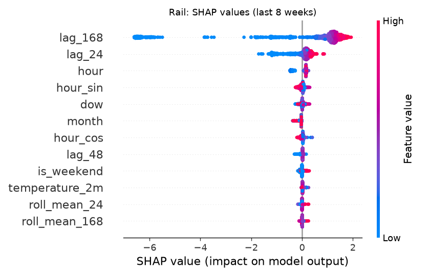
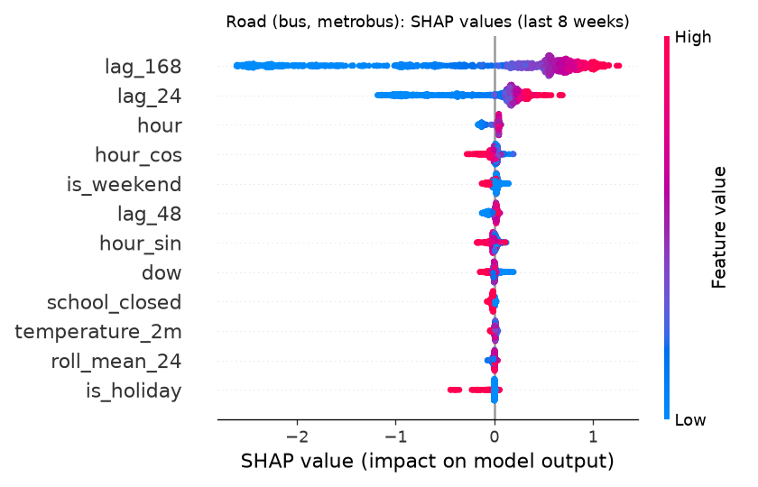
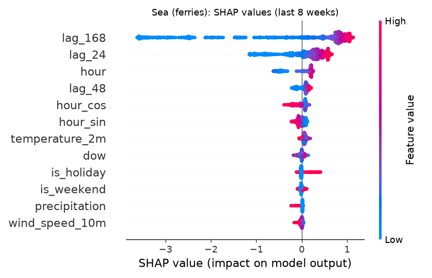

# Explainability and day-ahead stress test

## What drives the forecasts (SHAP)

SHAP values from `shap.TreeExplainer` on the published models, computed on the last 8 weeks of data. The models use a Poisson loss, so SHAP values are on the log scale: +0.1 means about 10% more passengers for that hour.

**Rail** — most important inputs: `lag_168`, `lag_24`, `hour`, `hour_sin`, `dow`.

**Road (bus, metrobus)** — most important inputs: `lag_168`, `lag_24`, `hour`, `hour_cos`, `is_weekend`.

**Sea (ferries)** — most important inputs: `lag_168`, `lag_24`, `hour`, `lag_48`, `hour_cos`.

## Day-ahead stress test: forecast weather instead of observed weather

Models trained on data before 2024-06-01, tested on 2024-06-01 – 2024-07-31 (hourly WAPE). The 'forecast' column feeds the weather forecast issued the day before, as a real day-ahead service would.

| Mode | Observed weather | Day-ahead forecast weather | Same hour last week |
|---|---|---|---|
| Rail | 5.65% | 5.70% | 12.91% |
| Road (bus, metrobus) | 4.76% | 4.82% | 12.42% |
| Sea (ferries) | 9.03% | 9.46% | 18.71% |

Using forecast weather costs little: weather explains a small part of hourly demand compared with the time of day, the calendar and last week's demand (see the SHAP plots).
