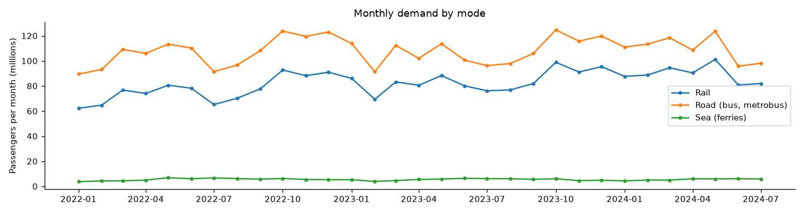
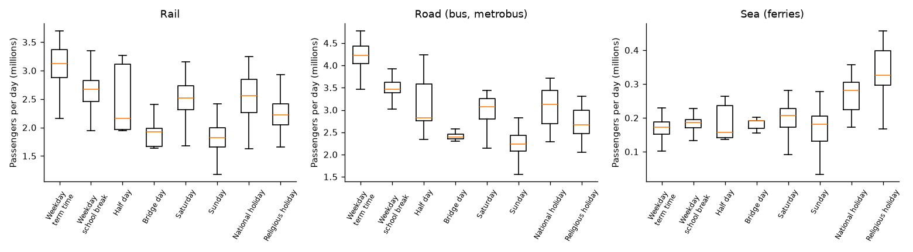
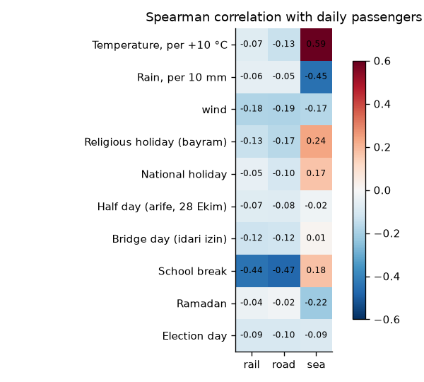
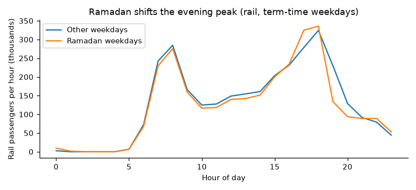

# Factors behind Istanbul transit demand

943 days (01 Jan 2022 – 31 Jul 2024), 6.07 billion passengers.

## Monthly demand

Average year-over-year change of monthly volume (%):

| transport_type   |   2023 |   2024 |
|:-----------------|-------:|-------:|
| rail             |   10.1 |   11.2 |
| road             |    1.3 |    5.6 |
| sea              |   -0.4 |    3   |

## Distribution by day type

Median passengers per day (millions):

| day_type              |   rail |   road |   sea |   days |
|:----------------------|-------:|-------:|------:|-------:|
| Weekday, term time    |   3.13 |   4.23 |  0.17 |    445 |
| Weekday, school break |   2.68 |   3.47 |  0.19 |    192 |
| Half day              |   2.16 |   2.82 |  0.16 |      5 |
| Bridge day            |   1.92 |   2.4  |  0.19 |      8 |
| Saturday              |   2.52 |   3.08 |  0.21 |    126 |
| Sunday                |   1.83 |   2.23 |  0.18 |    128 |
| National holiday      |   2.56 |   3.12 |  0.28 |     18 |
| Religious holiday     |   2.23 |   2.67 |  0.33 |     21 |

## Correlations

Raw (unadjusted) Spearman correlations. They mix effects together: for example school breaks fall in warm months, so temperature and school breaks look alike. The regression below separates them.

## Ramadan

Largest drop: -41.7% at 19:00 (around iftar); largest rise: +1657.2% at 01:00.

## Effect of each factor, holding the others fixed

OLS on log daily passengers with weekday, month and year fixed effects, rain, temperature and every calendar flag; Newey-West (HAC) standard errors. Effects are % change vs an otherwise identical day.

### Rail (R² = 0.88)

| factor                     | effect (95% CI)         | p      |   days |
|:---------------------------|:------------------------|:-------|-------:|
| Religious holiday (bayram) | -14.7% (-23.7 to -4.5)  | 0.006  |     21 |
| National holiday           | -2.2% (-10.0 to +6.2)   | 0.598  |     18 |
| Half day (arife, 28 Ekim)  | -12.5% (-19.1 to -5.3)  | <0.001 |      8 |
| Bridge day (idari izin)    | -31.1% (-35.7 to -26.1) | <0.001 |      8 |
| School break               | -7.8% (-10.6 to -4.9)   | <0.001 |    326 |
| Ramadan                    | -4.9% (-8.7 to -1.0)    | 0.014  |     89 |
| Election day               | -32.6% (-42.1 to -21.5) | <0.001 |      3 |
| Rain, per 10 mm            | -5.8% (-7.3 to -4.2)    | <0.001 |    943 |
| Temperature, per +10 °C    | +6.3% (+2.7 to +9.9)    | <0.001 |    943 |

### Road (bus, metrobus) (R² = 0.89)

| factor                     | effect (95% CI)         | p      |   days |
|:---------------------------|:------------------------|:-------|-------:|
| Religious holiday (bayram) | -18.4% (-26.8 to -9.0)  | <0.001 |     21 |
| National holiday           | -7.8% (-14.9 to +0.0)   | 0.050  |     18 |
| Half day (arife, 28 Ekim)  | -9.3% (-16.9 to -1.0)   | 0.029  |      8 |
| Bridge day (idari izin)    | -31.7% (-36.1 to -26.9) | <0.001 |      8 |
| School break               | -10.6% (-13.4 to -7.7)  | <0.001 |    326 |
| Ramadan                    | -2.2% (-6.0 to +1.6)    | 0.252  |     89 |
| Election day               | -28.6% (-33.9 to -22.9) | <0.001 |      3 |
| Rain, per 10 mm            | -5.5% (-7.1 to -3.9)    | <0.001 |    943 |
| Temperature, per +10 °C    | +7.5% (+3.2 to +11.9)   | <0.001 |    943 |

### Sea (ferries) (R² = 0.66)

| factor                     | effect (95% CI)         | p      |   days |
|:---------------------------|:------------------------|:-------|-------:|
| Religious holiday (bayram) | +79.0% (+63.1 to +96.6) | <0.001 |     21 |
| National holiday           | +39.3% (+22.8 to +58.0) | <0.001 |     18 |
| Half day (arife, 28 Ekim)  | -12.4% (-22.5 to -1.0)  | 0.034  |      8 |
| Bridge day (idari izin)    | +1.7% (-6.9 to +11.2)   | 0.705  |      8 |
| School break               | -2.1% (-8.0 to +4.3)    | 0.514  |    326 |
| Ramadan                    | -9.3% (-15.7 to -2.4)   | 0.009  |     89 |
| Election day               | -42.7% (-54.7 to -27.5) | <0.001 |      3 |
| Rain, per 10 mm            | -22.1% (-25.6 to -18.4) | <0.001 |    943 |
| Temperature, per +10 °C    | +31.5% (+20.6 to +43.3) | <0.001 |    943 |
