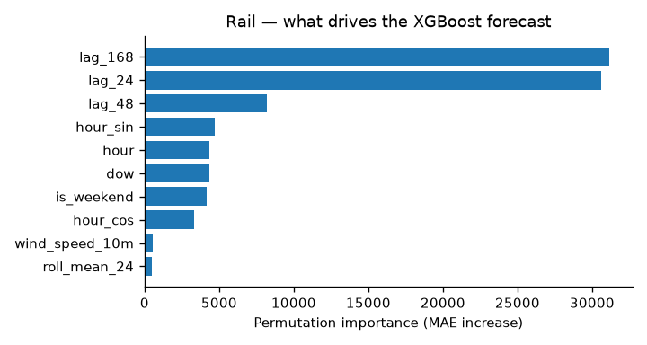

# Results (İBB data, January–July 2024)

Data: 15,336 hourly rows, 213 days, 1.43 billion recorded passengers (rail 625 M, road 769 M, sea 38 M).
Weather: Open-Meteo hourly archive for central Istanbul. Holidays: `holidays` package (incl. eves).

## Demand patterns

## Statistical tests

Working days only (Mon–Fri, excluding holiday eves). Rainy day = at least 2 mm of rain between 06:00 and 22:00; dry day = under 0.2 mm. Percentile bootstrap (5,000 resamples) and two-sided Mann-Whitney U test.

| Mode | Rain effect | Public-holiday effect |
|---|---|---|
| rail | -1.8% (95% CI -5.4% to +1.9%, p=0.139, not significant; n=31 vs 84) | -23.5% (95% CI -30.7% to -15.4%, p=0.000, significant; n=10 vs 143) |
| road | -1.9% (95% CI -5.9% to +2.3%, p=0.054, not significant; n=31 vs 84) | -30.8% (95% CI -35.5% to -25.0%, p=0.000, significant; n=10 vs 143) |
| sea | -14.8% (95% CI -20.8% to -9.0%, p=0.000, significant; n=31 vs 84) | +75.8% (95% CI +40.4% to +106.3%, p=0.000, significant; n=10 vs 143) |

## Forecasting (hourly, day-ahead features)

Expanding-window walk-forward validation, 4 folds × 14 days. All lag features end at least 24 h before the forecast hour (enforced by a unit test).

### Rail (metro, Marmaray, tram)

| model                      |     MAE |   sMAPE |   WAPE |   WAPE vs naive |
|:---------------------------|--------:|--------:|-------:|----------------:|
| XGBoost                    | 11139   |   38.5  |  10.14 |          -26.5  |
| Gradient boosting          | 12396   |   40.38 |  11.3  |          -18.15 |
| Seasonal naive (last week) | 15109.4 |   23.39 |  13.8  |            0    |
| Ridge                      | 15697.2 |   51.96 |  14.34 |            3.9  |

### Road (bus, metrobus)

| model                      |     MAE |   sMAPE |   WAPE |   WAPE vs naive |
|:---------------------------|--------:|--------:|-------:|----------------:|
| XGBoost                    | 11935.9 |   17.67 |   9.15 |          -30.09 |
| Gradient boosting          | 13125.1 |   19.65 |  10.1  |          -22.84 |
| Seasonal naive (last week) | 17051.2 |   13.32 |  13.09 |            0    |
| Ridge                      | 18417.5 |   44.06 |  14.13 |            7.91 |

