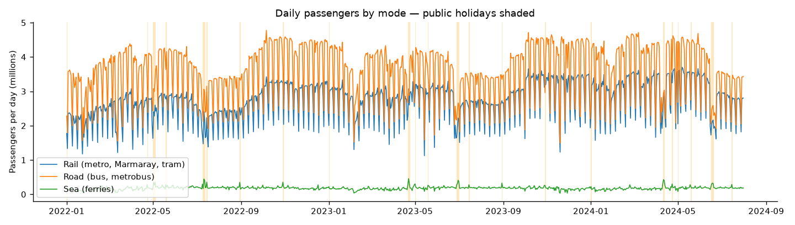

# Results (İBB data, January–July 2024)

Data: 15,336 hourly rows, 213 days, 1.43 billion recorded passengers (rail 625 M, road 769 M, sea 38 M).
Weather: Open-Meteo hourly archive for central Istanbul. Holidays: `holidays` package (incl. eves). School breaks: MEB calendar (`SCHOOL_BREAKS`).

## Demand patterns

## Statistical tests

Working days only (Mon–Fri, excluding holiday eves; rain and holiday tests also exclude school breaks). Rainy day = at least 2 mm of rain between 06:00 and 22:00; dry day = under 0.2 mm. Percentile bootstrap (5,000 resamples) and two-sided Mann-Whitney U test.

| Mode | Rain effect | Public-holiday effect | School-break effect |
|---|---|---|---|
| rail | -4.0% (95% CI -6.4% to -1.5%, p=0.005, significant; n=22 vs 57) | -27.4% (95% CI -34.3% to -19.7%, p=0.000, significant; n=10 vs 102) | -17.0% (95% CI -19.4% to -14.8%, p=0.000, significant; n=40 vs 102) |
| road | -4.3% (95% CI -6.2% to -2.3%, p=0.000, significant; n=22 vs 57) | -35.0% (95% CI -39.5% to -29.6%, p=0.000, significant; n=10 vs 102) | -20.6% (95% CI -23.0% to -18.4%, p=0.000, significant; n=40 vs 102) |
| sea | -17.9% (95% CI -24.7% to -10.8%, p=0.000, significant; n=22 vs 57) | +76.9% (95% CI +40.8% to +107.4%, p=0.000, significant; n=10 vs 102) | +2.4% (95% CI -2.3% to +7.2%, p=0.260, not significant; n=40 vs 102) |

## Forecasting (hourly, day-ahead features)

Expanding-window walk-forward validation, 4 folds × 14 days. All lag features end at least 24 h before the forecast hour (enforced by a unit test).

### Rail (metro, Marmaray, tram)

| model                      |     MAE |   sMAPE |   WAPE |   WAPE vs naive |
|:---------------------------|--------:|--------:|-------:|----------------:|
| Gradient boosting          | 10246.7 |   27.19 |   9.37 |          -32.08 |
| XGBoost                    | 10888.5 |   27.13 |   9.97 |          -27.74 |
| Ridge                      | 14018.2 |   46.2  |  12.84 |           -6.98 |
| Seasonal naive (last week) | 15109.4 |   23.39 |  13.8  |            0    |

### Road (bus, metrobus)

| model                      |     MAE |   sMAPE |   WAPE |   WAPE vs naive |
|:---------------------------|--------:|--------:|-------:|----------------:|
| Gradient boosting          | 10492   |    9.43 |   8.07 |          -38.35 |
| XGBoost                    | 10481.5 |    9.3  |   8.09 |          -38.24 |
| Ridge                      | 16046.2 |   42.62 |  12.33 |           -5.86 |
| Seasonal naive (last week) | 17051.2 |   13.32 |  13.09 |            0    |

