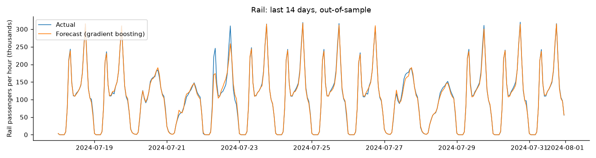

# Results (İBB data, January 2022 – July 2024)

Data: 67,896 hourly rows, 943 days, 6.07 billion recorded passengers (rail 2,555 M, road 3,347 M, sea 170 M).
Weather: Open-Meteo hourly archive for central Istanbul. Holidays: `holidays` package (incl. eves). School breaks: MEB calendar (`SCHOOL_BREAKS`).

## Demand patterns

## Statistical tests

Working days only (Mon–Fri, excluding holiday eves; rain and holiday tests also exclude school breaks). Rainy day = at least 2 mm of rain between 06:00 and 22:00; dry day = under 0.2 mm. Percentile bootstrap (5,000 resamples) and two-sided Mann-Whitney U test.

| Mode | Rain effect | Public-holiday effect | School-break effect |
|---|---|---|---|
| rail | -4.8% (95% CI -7.6% to -1.9%, p=0.003, significant; n=84 vs 273) | -21.3% (95% CI -25.9% to -16.6%, p=0.000, significant; n=25 vs 446) | -14.6% (95% CI -16.3% to -13.1%, p=0.000, significant; n=198 vs 446) |
| road | -6.0% (95% CI -8.1% to -4.0%, p=0.000, significant; n=84 vs 273) | -29.2% (95% CI -33.0% to -25.6%, p=0.000, significant; n=25 vs 446) | -17.5% (95% CI -18.8% to -16.3%, p=0.000, significant; n=198 vs 446) |
| sea | -21.8% (95% CI -25.7% to -17.8%, p=0.000, significant; n=84 vs 273) | +89.9% (95% CI +71.8% to +106.6%, p=0.000, significant; n=25 vs 446) | +5.1% (95% CI +2.0% to +8.2%, p=0.000, significant; n=198 vs 446) |

## Forecasting (hourly, day-ahead features)

Expanding-window walk-forward validation, 4 folds × 14 days. All lag features end at least 24 h before the forecast hour (enforced by a unit test).

### Rail (metro, Marmaray, tram)

| model                      |      MAE |   sMAPE |   WAPE |   WAPE vs naive |
|:---------------------------|---------:|--------:|-------:|----------------:|
| Gradient boosting          |  6093.66 |   26.35 |   5.58 |          -59.56 |
| XGBoost                    |  6240.68 |   26.46 |   5.71 |          -58.63 |
| Ridge                      | 12862.9  |   46.17 |  11.76 |          -14.81 |
| Seasonal naive (last week) | 15109.4  |   23.39 |  13.8  |            0    |

### Road (bus, metrobus)

| model                      |      MAE |   sMAPE |   WAPE |   WAPE vs naive |
|:---------------------------|---------:|--------:|-------:|----------------:|
| XGBoost                    |  6114.68 |    5.92 |   4.68 |          -64.23 |
| Gradient boosting          |  6726.3  |    6.53 |   5.15 |          -60.69 |
| Ridge                      | 15078.3  |   36.81 |  11.56 |          -11.68 |
| Seasonal naive (last week) | 17051.2  |   13.32 |  13.09 |            0    |

